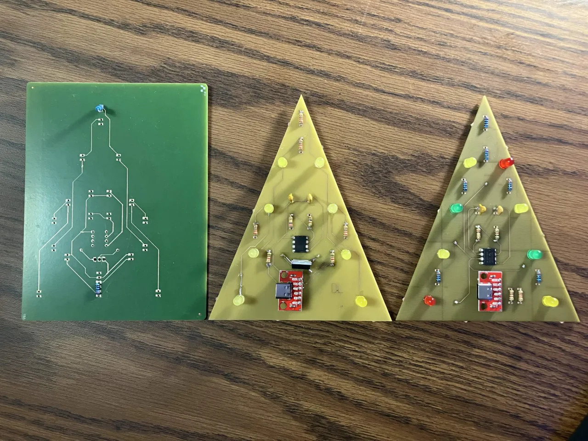

# ECE Discovery Project

## The Objective

The objective of this project was to learn how to design and fabricate a two-layer printed circuit board fully in-house. Required skills include PCB CAD software like KiCAD, using integrated circuits and varying electrical components, soldering, and fabricating using a ProtoMat and ProtoLaser.

## The Process

My initial idea was to fabricate a Christmas Tree-like circuit board which included a triangular-shaped substrate and two sets of four oscillating yellow LEDs. Before attempting fabrication, I built a prototype on a breadboard. This first prototype included a 555 timer circuit and its necessary resistors and capacitors, an NMOS transistor, and LEDs and their necessary resistors. Once verifying this design, I designed the two-layered circuit board in KiCAD.

I initially attempted to fabricate the circuit board on a Voltera PCB printer. This printer utilizes additive manufacturing to print metal traces using conductive ink. However, this process was not reliable as some of the traces failed the continuity test of a multimeter.

To overcome this hurdle, I pivoted to subtractive manufacturing on a ProtoMat and ProtoLaser. These pieces of equipment drill through copper-plated substrate before etching away unnecessary copper using a laser. After repeating the process on both sides of the substrate, the board is cut and the skeleton is complete. The first fabrication attempt failed due to a misalignment while flipping the substrate. The second fabrication succeeded, but I decided to make some design revisions before soldering a final board. Since the ProtoMat and ProtoLaser could not plate through-holes, I decided to move as many traces as possible to the bottom side of the board to make soldering easier and more reliable. I also removed the need for the transistor by pairing some LEDs to their own resistors.

After design revisions, I successfully fabricated and soldered components to the final board.

Image: All fabricated prototypes

## The Outcome

The final result of this project is a two-layered triangular printed circuit board with the following components: 555 timer (integrated circuit), 2 capacitors, 10 resistors, and 8 LEDs of varying color that oscillate with only half of the lights emitting light at any given time.

GIF: Final design

